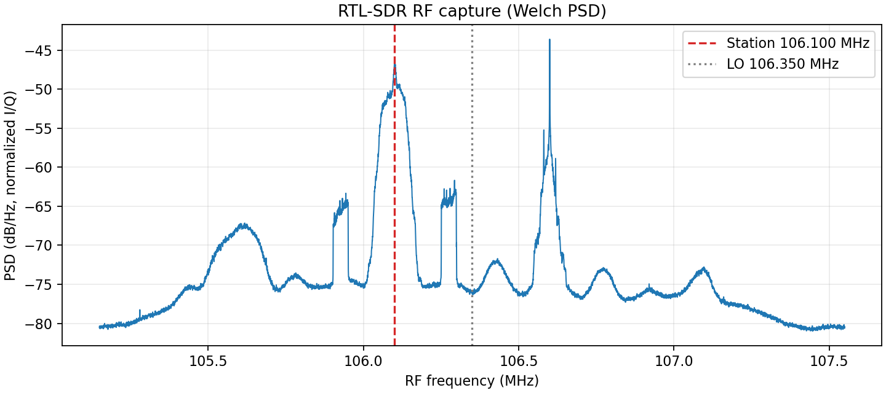
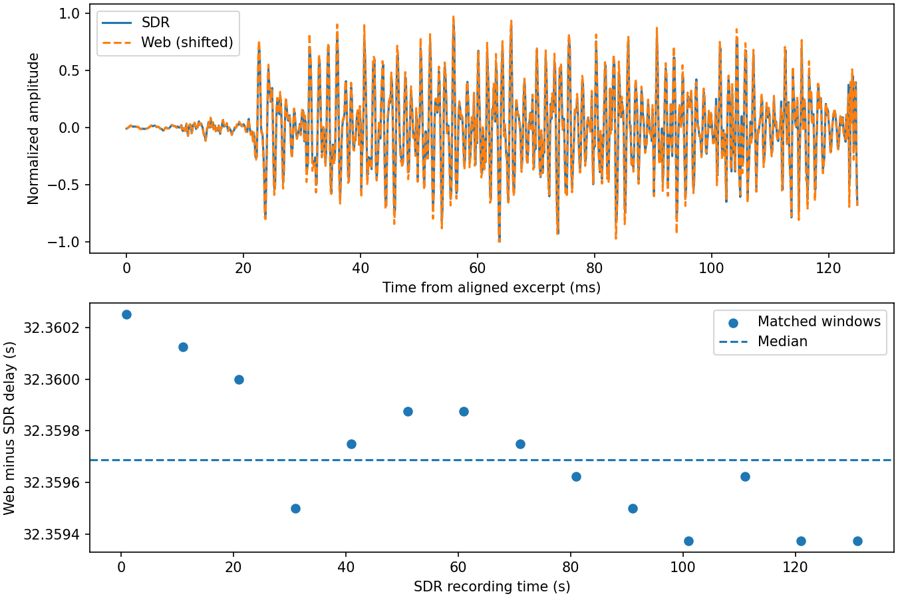

# 实验二　SDR6 V4 接收 FM 与直播延时测量

2026 年 11 月 24 日 00:06:43（北京时间）起，在北京同步录制 **FM 106.1 MHz 中国之声**与央广网同频道的官方直播。180 秒录音中有 14 个有效匹配片段，网络音频比 FM 解调音频晚 **32.36 秒**。原测量的浏览器启动受限，网络端采用 FFmpeg 播放官方 HLS 流。该数值对应当时的直播与播放器配置。[北京收听频率](https://www.cnr.cn/cbu_1/) · [央广网广播直播](https://www.cnr.cn/gbzb/) · [原始录音元数据](results/fm/cnr-1061.capture.json)

## GNU Radio 接收流图

电视棒由 WinUSB 和 RTL-SDR 用户态库驱动。GNU Radio 用 Osmocom 读取 I/Q。106.350 MHz 的本振使 106.100 MHz 目标信道位于 I/Q 的 −250 kHz，避开零频直流分量。接收程序默认请求 28 dB 手动调谐器增益，实际增益取硬件支持的档位。[驱动安装](电视棒驱动安装.md) · [接收源码](programs/fm_receiver.py)

```text
天线 → SDR6 V4 / Osmocom Source（2.4 MS/s 复 I/Q）
     → 选取 −250 kHz 信道并移至零频，低通并抽取 5 倍（480 kS/s）
     → FM 相位差鉴频 → 音频低通并抽取 10 倍（48 kS/s）
     → 去直流 → 50 µs 去加重 → 单声道声卡或 WAV
```

信道 FIR 低通截止参数为 105 kHz，过渡带宽 40 kHz。鉴频增益为 `480000 / (2π × 75000)`，将 ±75 kHz 频偏标为约 ±1。音频低通截止参数为 15.5 kHz，过渡带宽 6 kHz，通路保留单声道并压制 19 kHz 导频。合成测试加入更强的邻频和 19 kHz 导频，恢复的主音调为 1 kHz，残余导频为 −75.8 dBc。[接收链自检](results/verification/receiver-synthetic.stdout.log)



功率谱由两秒电视棒 I/Q 数据计算，用 8192 点 Welch FFT，红线标出目标频率，灰线标出本振。另一次 12 秒实收验证生成了单声道解调音频。[原始 I/Q](results/fm/rtl-probe.cu8) · [频谱绘图程序](programs/plot_rf.py) · [12 秒解调 WAV](results/fm/fm-1061.wav)

## 双路录音与对齐

[录音程序](programs/capture_live.py) 从央广网直播页对应的官方频道列表查找中国之声 HLS 地址。GNU Radio 的解调音频写入左声道，FFmpeg 实时解码的直播音频写入右声道。两路分别预缓冲 0.2 秒，由同一个 48 kHz 立体声输出回调生成双声道 WAV。归档元数据中，两路缺样和丢样计数、声卡输出错误计数均为 0。[央广网频道列表](https://apppc.cnr.cn/national) · [双路原始录音](results/fm/cnr-1061.wav)

[延时程序](programs/measure_delay.py) 将两路降至 8 kHz，保留 300–3300 Hz。每隔 10 秒从 FM 音轨取 8 秒片段，在网络音轨中搜索 ±60 秒，按归一化互相关寻找相同内容。保留绝对相关系数至少 0.32、峰突出度至少 0.05 的匹配，再从至少包含三个窗口且占候选多数的延时组取中位数。正值表示网络晚于 FM。

| 项目 | 结果 |
| --- | ---: |
| 录制时长 | 180 s |
| 有效匹配窗口 | 14 |
| 相对时差中位数 | **+32.36 s** |
| 有效窗口时差范围 | 32.3594–32.3603 s |
| 有效窗口绝对相关系数中位数 | 0.860 |

离线复核用原始录音重算出同样的数值。逐段时差范围描述同一录制时段内的波动。合成测试覆盖了正时差、负时差、MKV 轨道时间戳偏移及无关音频拒识。[逐段数据](results/fm/delay.json) · [算法自检](results/verification/delay-synthetic.stdout.log)



## 延时原因

- **起播位置与分段。** 复核时从同一频道读取的 HLS 分段时长约 10.005–10.006 秒。录制脚本以 `live_start_index=-3` 从清单末尾倒数第三个分段的起点播放，该位置距清单末尾约 30 秒，足以解释观测时差的量级。[FFmpeg HLS 参数](https://ffmpeg.org/ffmpeg-formats.html#hls)
- **网络分发和播放。** 节目信号经编码、分段发布、CDN 分发、下载与解码。清单刷新时机、播放器的起播位置和缓冲策略均可改变可听时差。
- **本地接收。** 电视棒的 USB 传输、GNU Radio 滤波、去加重及音频缓冲会延迟 FM 端。双路音频对齐得到的是两条完整链路的相对时差，各环节的延时需单独测量。

## 复现步骤

按[安装文档](GNU%20Radio安装.md)设置 `$radio` 和 `PATH`，确认 [FFmpeg](录音工具安装.md) 可用。在仓库根目录运行以下命令。接收、单路录音与双路录音应依次执行，防止同时占用电视棒。

```powershell
# 回放实时解调音频和射频频谱，关闭窗口后继续
& "$radio\python.exe" .\programs\fm_receiver.py --frequency 106.1

# 用电视棒重新录制 12 秒 FM 音频
& "$radio\python.exe" .\programs\fm_receiver.py --no-gui --no-audio --seconds 12 --wav output/fm/fm-1061.wav

# 同时录制电视棒和央广网节目，计算新时差
& "$radio\python.exe" .\programs\capture_live.py --duration 180 --output output/fm/cnr-1061.wav
& "$radio\python.exe" .\programs\measure_delay.py output/fm/cnr-1061.wav --stereo --output output/fm/repeat-delay.json

# 从归档重算频谱与时差，可在电视棒未连接时运行
& "$radio\python.exe" .\programs\plot_rf.py results/fm/rtl-probe.cu8 --output output/fm/rf-1061.png
& "$radio\python.exe" .\programs\measure_delay.py results/fm/cnr-1061.wav --stereo --output output/fm/archive-delay.json
```

### 浏览器播放路径

在浏览器打开央广网广播直播并选择中国之声。在 OBS 中分别采集 GNU Radio 接收程序和浏览器的应用音频，把 FM 音频设为第 1 轨、浏览器音频设为第 2 轨，关闭全局桌面音频和麦克风来源。录制时选 MKV 并启用这两条轨道。[央广网广播直播](https://www.cnr.cn/gbzb/) · [OBS 应用音频采集](https://obsproject.com/kb/application-audio-capture-guide) · [OBS 多音轨录制](https://obsproject.com/kb/multiple-audio-track-recording-guide)

```powershell
& "$radio\python.exe" .\programs\measure_delay.py output/fm/browser.mkv --output output/fm/browser-delay.json
```
